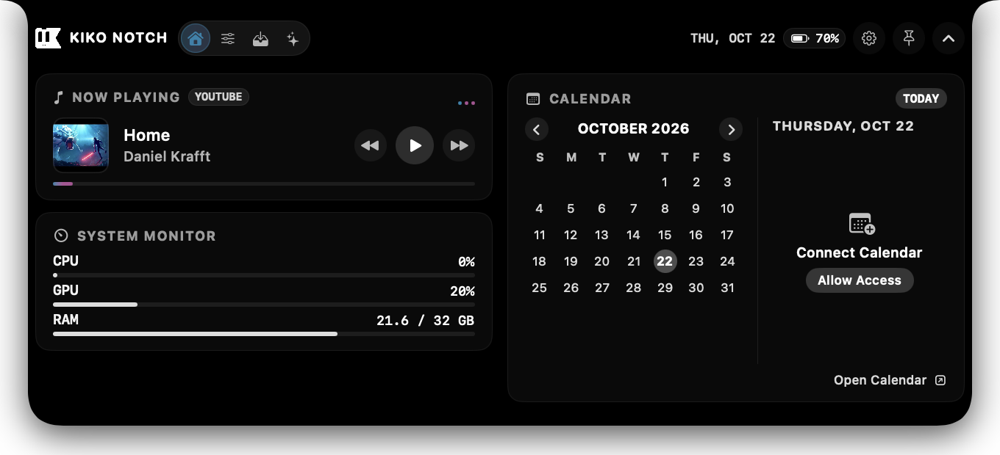
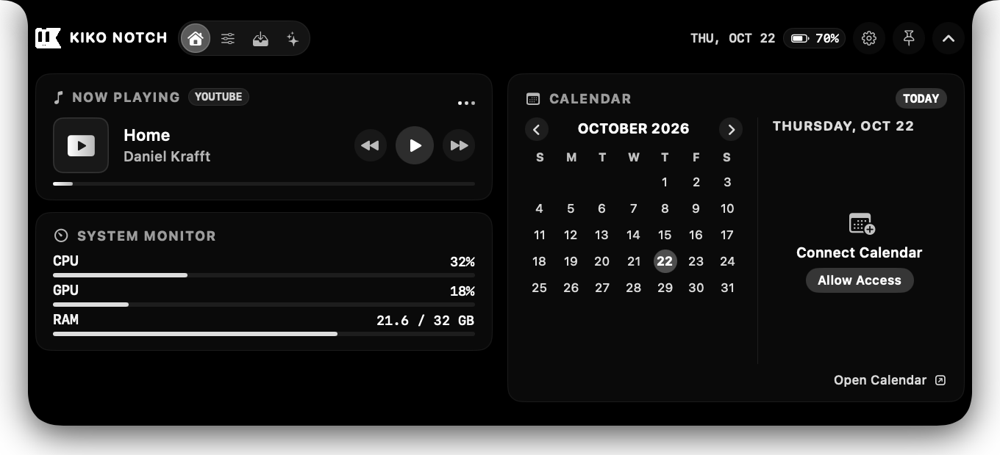
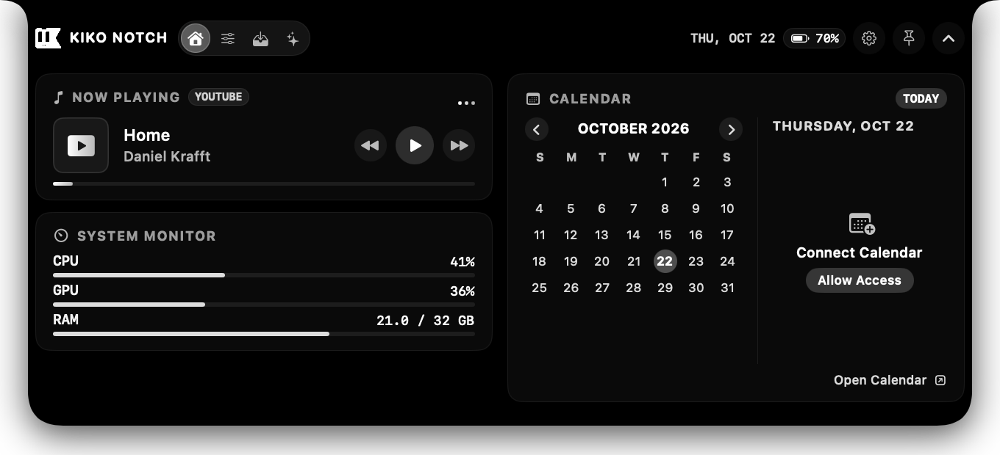
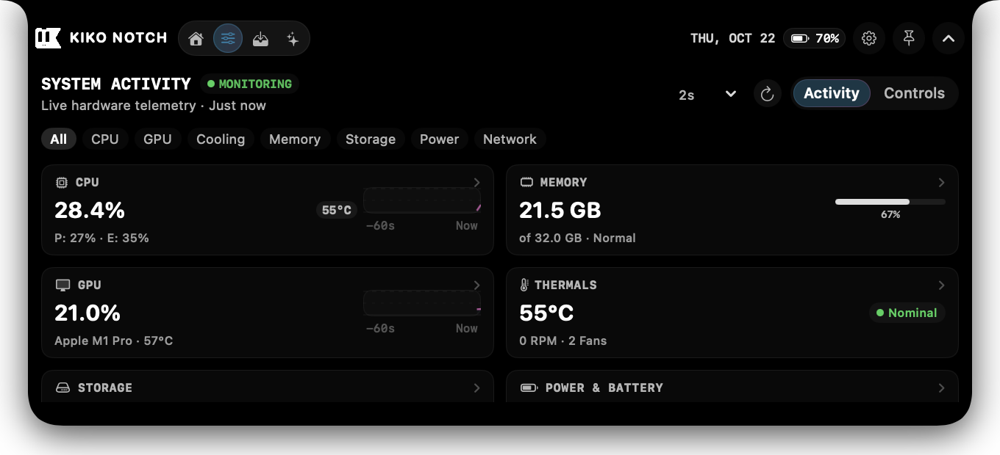
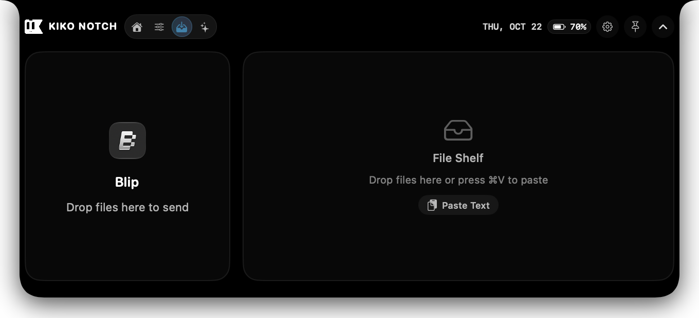
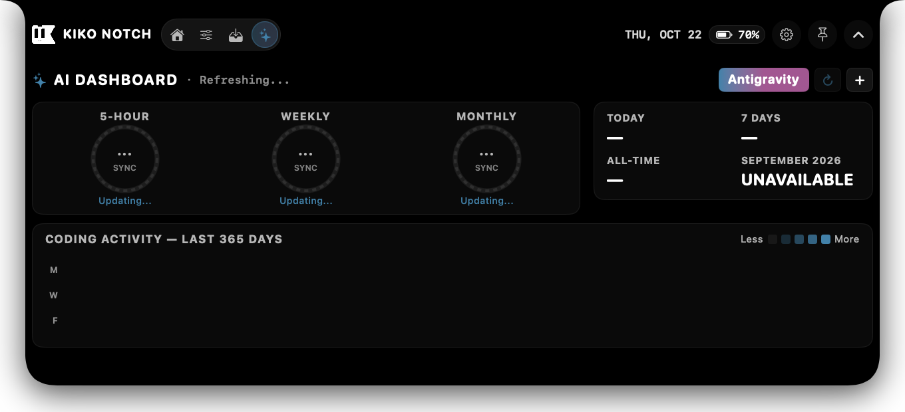
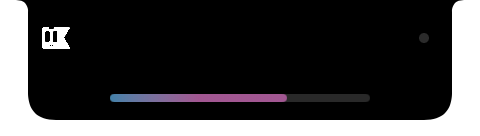
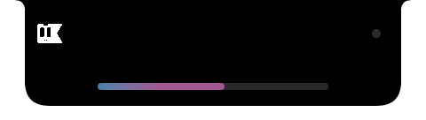

# Kiko Notch

Native macOS notch companion and expandable dynamic island application built with Swift, AppKit, and SwiftUI.



## Overview

Modern MacBooks integrate a physical display notch that occupies screen real estate without providing system utility. On displays without a notch, the top-center menu bar area remains largely static.

Kiko Notch transforms the camera notch—or creates a compact floating island on external monitors—into an interactive utility hub. It unifies media playback control, real-time hardware telemetry, temporary drag-and-drop file staging, developer AI usage tracking, and contextual volume and brightness indicators directly into the physical notch footprint.

## Features

### Collapsed Notch and Idle State

In its collapsed state, Kiko Notch rests flush against the hardware camera cutout, maintaining the native display curvature. It provides glanceable status indications, including active playback states, an integrated audio visualizer, and contextual notification alerts while consuming zero sensor CPU cycles when idle.


### Universal Media Player and Dynamic Gradient Accents

Kiko Notch detects active media sessions and metadata across Apple Music, Spotify, YouTube in supported browsers, and system audio streams.

- Palette Extraction: Uses a local 12-hue-bin quantization engine to analyze album artwork and video thumbnails, extracting coordinated two- or three-color gradient palettes.
- Fluid Theming: Dynamically tints the collapsed island border, real-time 3-bar audio visualizer, playback progress scrubbers, and active navigation indicators.
- Transition Curves: Applies 0.85-second cubic ease animations between tracks with normalized gradient color stops to prevent visual clipping.
- Playback State Management: Retains extracted artwork palettes during paused playback, and smoothly returns to monochrome neutral tones when playback terminates.





### System Monitoring and Hardware Telemetry

The dedicated System Activity dashboard tracks real-time hardware performance directly from macOS kernel and hardware APIs without polling overhead:

- CPU Utilization: Sampled via Mach kernel `host_processor_info` APIs, including per-core loads and a 60-sample historical sparkline graph.
- Memory Distribution: Mach virtual memory statistics reporting active, wired, compressed, and free memory allocations alongside system memory pressure.
- Storage Diagnostics: Real-time volume capacity, used space, and free disk space tracking via `FileManager`.
- Network Throughput: Live upload and download data rates measured via kernel network interface counters (`getifaddrs`).
- Thermal and Fan Telemetry: Thermal state monitoring and cooling fan speeds queried through SMC and IOKit interfaces.
- Battery and Power Metrics: Hardware charging state, wattage throughput, health condition, and estimated runtime via `IOPowerSources`.
- GPU Hardware Identification: Model detection and unified memory architecture details queried via Metal.



### Temporary File Shelf

The File Shelf provides a persistent staging zone for temporary files, eliminating desktop clutter and simplifying multi-window drag-and-drop workflows.

- Staging: Drag files or folders into the island from Finder, browsers, or other applications.
- Preview and Metadata: Generates QuickLook previews and displays file dimensions, sizes, and formats with monochrome iconography.
- Direct Sharing: Integrated native macOS sharing options, including AirDrop transfers and clipboard copying.
- Persistence: Staged items remain available across application launches in local application support storage.



### AI Developer Usage Dashboard

Designed for engineers using agentic AI coding tools and LLM platforms, the AI Usage view provides unified visibility into quota consumption and coding activity:

- Provider Tracking: Session metrics, burn rates, and quota resets for Antigravity, Claude, and OpenAI Codex.
- Security: API keys and credentials are stored exclusively in the macOS system Keychain.
- WakaTime Integration: Tracks daily and cumulative programming time, active projects, and language breakdowns via the WakaTime API.
- Truthful Telemetry: Explicitly distinguishes real quota measurements from estimated metrics, avoiding fabricated readings.



### Native Contextual Progress Indicators

Kiko Notch replaces default on-screen display banners with compact progress bars placed directly beneath the physical notch.

- Contextual Triggering: Automatically displays whenever system output volume or display brightness changes.
- Minimal Interface: Appears both when the island is collapsed and when expanded, presenting solely the active level without redundant icons or numeric badges.
- Smooth Dismissal: Fades out automatically following adjustments, leaving the screen free of visual obstruction.





## Architecture

Kiko Notch is organized into modular targets using the Swift Package Manager:

- `Sources/KikoNotchKit`: Core implementation library containing business logic, hardware telemetry collectors, media observers, palette extraction, and SwiftUI views.
- `Sources/KikoNotchApp`: AppKit application shell, NSApplicationDelegate, status bar management, and window controller wiring.
- `Tests/KikoNotchTests`: Comprehensive automated unit and integration tests.

### Source Layout

```
Sources/KikoNotchKit/
├── AI/                 # AI provider interfaces, Keychain storage, and WakaTime API
├── Appearance/         # Palette extraction, DesignTokens, NotchShape, and themes
├── Clipboard/          # Clipboard history cache and pasteboard observers
├── Core/               # AppLifecycle, IslandWindowController, and DisplayManager
├── FileShelf/          # FileShelfManager, drag-and-drop staging, and file sharing
├── Media/              # MediaController, ArtworkColorExtractor, and audio observers
├── Navigation/         # IslandNavigation state and tab coordination
├── Sensors/            # Battery and hardware sensor listeners
├── Settings/           # Preferences views, shortcut registration, and persistence
├── SystemHUD/          # NotchIndicatorManager and contextual progress bars
├── SystemMetrics/      # Mach kernel telemetry, SMC sensors, and Metal queries
└── Views/              # SwiftUI views for collapsed, expanded, and tabbed island layouts
```

## Requirements

- macOS 13.0 (Ventura) or newer
- Apple Silicon (M1/M2/M3/M4) or Intel processor
- Xcode 15.0+ or Command Line Tools (for building from source)

## Installation

### Download Pre-built Release

1. Download the release archive `Kiko-Notch-v1.0.0-macOS.zip` from [GitHub Releases](https://github.com/rtomswastaken/kiko-notch/releases/latest).
2. Uncompress the archive:
   ```bash
   unzip Kiko-Notch-v1.0.0-macOS.zip
   ```
3. Move `Kiko Notch.app` to your `/Applications` directory:
   ```bash
   mv "Kiko Notch.app" /Applications/
   ```
4. Open Kiko Notch from `/Applications` or via Spotlight.

#### Checksum Verification

```bash
shasum -a 256 Kiko-Notch-v1.0.0-macOS.zip
```
Expected SHA-256:
```
dd9f55ffe4bd639a5417881e9724c153865a4129725049255e8b044e11b61a7c
```

#### macOS Gatekeeper

Because Kiko Notch is built directly from source as an open-source project, macOS Gatekeeper may prompt on initial launch:

1. Right-click `Kiko Notch.app` in Finder.
2. Select Open.
3. Click Open in the confirmation prompt.

Alternatively, remove the quarantine flag via Terminal:
```bash
xattr -cr "/Applications/Kiko Notch.app"
```

## Building from Source

Clone the repository and build the production bundle:

```bash
git clone https://github.com/rtomswastaken/kiko-notch.git
cd kiko-notch
./Scripts/package_app.sh release
open .build/release/KikoNotch.app
```

## Automated Testing

Run the test suite using Swift Package Manager:

```bash
swift run KikoNotchTests
```

The test runner executes 185 unit and integration tests across 19 suites, covering Mach telemetry calculation, palette extraction, media observation, file shelf staging, and UI geometry clamping.

## Configuration

Preferences can be modified by clicking the settings gear icon in the island or from the menu bar:

- Hotkey: Toggle the expanded island with a configurable global shortcut (default: `Option + Space`).
- Launch at Login: Register Kiko Notch via macOS `SMAppService`.
- Display Selection: Automatically position on the primary display with a physical notch, or select a specific connected monitor.
- Gestures: Hover over the notch area to peek, click to lock expanded, or use trackpad swipe gestures to switch tabs.

## Known Limitations

- GPU Instantaneous Core Load: macOS restricts dynamic per-core GPU execution metrics behind private Apple Silicon entitlements. Kiko Notch displays verified GPU hardware model and memory configuration, marking core load as unavailable rather than reporting estimated values.
- Media Automation Permissions: Controlling third-party media players (Spotify, Apple Music) requires granting automation permission in System Settings > Privacy & Security > Automation.

## Attribution and License

Kiko Notch incorporates foundational window management, notch detection, and geometry concepts from [Boring Notch](https://github.com/TheBoredTeam/boring.notch) by TheBoredTeam, licensed under the GNU General Public License v3.0.

See [NOTICE](NOTICE) and [docs/THIRD_PARTY_LICENSES.md](docs/THIRD_PARTY_LICENSES.md) for full upstream attribution and copyright notices.

This software is licensed under the GNU General Public License v3.0. See the [LICENSE](LICENSE) file for terms.
