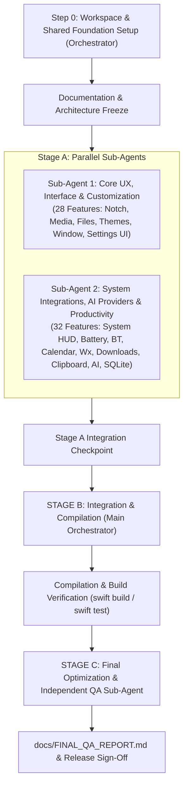

# Kiko Notch — Agent Execution Plan

> **Document Type**: Agent Coordination & Workstream Architecture  
> **Status**: Active Operational Plan  
> **Target Release**: Kiko Notch v1.0.0  
> **Last Updated**: 2026-10-18  

---

## 1. Multi-Stage Execution Architecture

To deliver all 65 requirements in [`docs/FEATURE_SPECIFICATION.md`](file:///Users/rtoms/Documents/antigravity/joyful-lavoisier/docs/FEATURE_SPECIFICATION.md) with native macOS quality, zero mockups, and strict architectural integrity, execution is partitioned into three discrete stages:



---

## 2. Stage A: Workstream Specifications & File Boundaries

### Strict File Ownership Matrix

To prevent merge collisions and race conditions during concurrent execution, each implementation agent operates within strictly defined directory boundaries:

| Directory / Domain | Sub-Agent 1 (Core UX & Customization) | Sub-Agent 2 (System, AI & Productivity) | Orchestrator / Shared |
|---|---|---|---|
| `Package.swift` | Read-only | Read-only | **Owner (Initial setup & SPM dependencies)** |
| `Sources/KikoNotch/Shared/` | Read-only consumer | Read-only consumer | **Owner (Shared Protocols, Models, State Contracts)** |
| `Sources/KikoNotch/Core/` | **Primary Owner** (Window, Display, Animation, Interaction, MenuBar) | No write access | Read/Review |
| `Sources/KikoNotch/Appearance/` | **Primary Owner** (Themes, Glass Materials, Colors, Geometry) | No write access | Read/Review |
| `Sources/KikoNotch/Media/` | **Primary Owner** (MediaController, AudioDevice, Metadata) | No write access | Read/Review |
| `Sources/KikoNotch/FileShelf/` | **Primary Owner** (FileShelfManager, DragDrop, QuickLook) | No write access | Read/Review |
| `Sources/KikoNotch/Views/` | **Primary Owner** (Island Container, Layout, UI Components) | Consumes or provides widget views | Coordination |
| `Sources/KikoNotch/Settings/` | **Primary Owner** (Settings Window, Appearance/General Tabs) | Contributes Provider & Feature Settings views | Coordination |
| `Sources/KikoNotch/SystemHUD/` | No write access | **Primary Owner** (AudioHUD, BrightnessHUD, Backlight) | Read/Review |
| `Sources/KikoNotch/Sensors/` | No write access | **Primary Owner** (BatteryMonitor, BluetoothMonitor) | Read/Review |
| `Sources/KikoNotch/Productivity/` | No write access | **Primary Owner** (CalendarService, ReminderService) | Read/Review |
| `Sources/KikoNotch/Notifications/` | No write access | **Primary Owner** (NotificationManager, AlertBanner) | Read/Review |
| `Sources/KikoNotch/Weather/` | No write access | **Primary Owner** (WeatherService, OpenMeteo, Location) | Read/Review |
| `Sources/KikoNotch/Downloads/` | No write access | **Primary Owner** (FSEvents DownloadMonitor) | Read/Review |
| `Sources/KikoNotch/Clipboard/` | No write access | **Primary Owner** (ClipboardManager, LocalStorage) | Read/Review |
| `Sources/KikoNotch/AI/` | No write access | **Primary Owner** (Antigravity, Codex, Claude, SQLite, Scheduler) | Read/Review |
| `Sources/KikoNotch/Security/` | No write access | **Primary Owner** (KeychainHelper) | Read/Review |
| `Sources/KikoNotch/Extensions/` | Views integration | **Primary Owner** (FeatureRegistry, ExtensionManager) | Coordination |
| `Tests/KikoNotchTests/` | Agent 1 Tests (`Core`, `Media`, `Theme`) | Agent 2 Tests (`AI`, `System`, `Storage`) | Integration & QA Tests |

---

## 3. Shared Data Contracts & Public Interfaces

The Orchestrator defines standard contracts in `Sources/KikoNotch/Shared/` before parallel execution starts:

### 3.1 Island State Contract (`Sources/KikoNotch/Shared/IslandState.swift`)
```swift
public enum IslandDisplayState: String, CaseIterable, Codable, Sendable {
    case collapsed
    case peek
    case expanded
    case pinned
}

public enum IslandPresentationMode: Sendable {
    case physicalNotch(notchRect: CGRect)
    case nonNotchFloatingPill(pillRect: CGRect)
}
```

### 3.2 AI Provider Protocol (`Sources/KikoNotch/Shared/AIProviderProtocol.swift`)
```swift
public enum AIProviderID: String, CaseIterable, Codable, Sendable {
    case antigravity
    case codex
    case claude
}

public struct AIUsageSnapshot: Codable, Sendable {
    public let providerID: AIProviderID
    public let timestamp: Date
    public let isAvailable: Bool
    public let sessionRequests: Int?
    public let sessionTokens: Int?
    public let remainingQuotaPercent: Double?
    public let quotaResetDate: Date?
    public let modelBreakdown: [String: Int]
    public let statusMessage: String
}

public protocol AIProviderAdapter: Sendable {
    var id: AIProviderID { get }
    var displayName: String { get }
    var isEnabledByDefault: Bool { get }
    func checkConnection() async -> Bool
    func fetchUsage() async throws -> AIUsageSnapshot
}
```

### 3.3 Feature & Extension Registry Contract (`Sources/KikoNotch/Shared/FeatureContract.swift`)
```swift
public protocol KikoFeatureModule: Sendable {
    var featureID: String { get }
    var name: String { get }
    var isEnabled: Bool { get }
    func start() async
    func stop() async
}
```

---

## 4. Stage A: Agent Task Assignments

### Sub-Agent 1: Core UX, Interface and Customization
- **Feature IDs**: `CORE-001` to `CORE-010`, `NOTCH-001` to `NOTCH-004`, `DISP-001` to `DISP-003`, `MEDIA-001` to `MEDIA-008`, `FILES-001` to `FILES-006`, `GEST-001` to `GEST-004`, `CUSTOM-001` to `CUSTOM-007`, `SET-001` to `SET-004`, `SET-006`, `ACC-001` to `ACC-003`.
- **Primary Deliverables**:
  1. `IslandWindowController` using native AppKit `NSPanel` / `NSWindow` with `.floating` or `.statusBar` level, non-activating panel behavior.
  2. `DisplayManager` detecting notch geometry on Apple Silicon MacBooks and providing floating bezel pill for non-notched Macs and external screens.
  3. `IslandAnimationEngine` with spring curve animations, peek/expand/collapse states, and reduced-motion adaptation.
  4. `InteractionManager` with hover tracking, click outside dismissal, drag-to-expand, and hotkey toggling.
  5. `ThemeManager`, `GlassBackgroundView`, and `ColorPalette` implementing native Liquid Glass appearance, frost/blur, custom tints, and geometry customization.
  6. `MediaController` integrating with macOS NowPlaying / AppleScript for Apple Music & Spotify, artwork caching, playback controls, and simulated equalizer visualizer without mic permissions.
  7. `FileShelfManager` with drag-and-drop drop-zone, multiple file reference staging, QuickLook thumbnails, drag-out, and native Share Sheet/AirDrop.
  8. `SettingsWindowController` and base SwiftUI tabs.

### Sub-Agent 2: System Integrations, AI Providers and Productivity
- **Feature IDs**: `SYS-001` to `SYS-005`, `BATT-001` to `BATT-003`, `BT-001` to `BT-002`, `PROD-001` to `PROD-004`, `NOTIF-001` to `NOTIF-003`, `WX-001` to `WX-004`, `DL-001` to `DL-003`, `CLIP-001` to `CLIP-004`, `AI-ANTIGRAVITY-001` to `AI-ANTIGRAVITY-006`, `AI-CODEX-001` to `AI-CODEX-003`, `AI-CLAUDE-001` to `AI-CLAUDE-003`, `AI-DASH-001` to `AI-DASH-004`, `EXT-001`, `EXT-003`, `SEC-001`, `ERR-001` to `ERR-002`.
- **Primary Deliverables**:
  1. `AudioHUDMonitor`, `BrightnessHUDMonitor`, `KeyboardBacklightMonitor` providing event-driven system HUD indicators with custom auto-dismiss durations.
  2. `BatteryMonitor` (`IOPowerSources`) and `BluetoothMonitor` (`IOBluetooth`) providing percentage, time estimates, connect/disconnect alerts.
  3. `CalendarService` & `ReminderService` (`EventKit`) displaying today's agenda, countdowns, and truthful permission handling.
  4. `WeatherService` using Open-Meteo REST API, CoreLocation or city search, caching, and offline recovery.
  5. `DownloadMonitor` using `FSEvents` watching `~/Downloads` for partial downloads (`.crdownload`, `.download`) and completion alerts.
  6. `ClipboardManager` and `ClipboardStorage` watching `changeCount`, supporting text/URL history, ignoring concealed passwords, with zero data upload.
  7. `AntigravityProvider` inspecting local `~/.gemini/antigravity` environment/sessions/quota, enabled by default, with truthful metric reporting.
  8. `CodexProvider` (disabled by default) and `ClaudeProvider` (independently configurable) using secure Keychain tokens.
  9. `UsageRepository` with SQLite3 database for timestamped AI metrics, history charts, export, and purge.
  10. `FeatureRegistry` and `ExtensionManager` with safe error handling and module isolation.

---

## 5. Stage B: Integration & Verification Protocol

### Verification Audit Results (Completed 2026-10-18):
1. **Source Cross-Check**: All 60 implementation features exist in code.
2. **Interface Binding**: `IslandExpandedView` and `SettingsRootView` fully integrate all widgets (AI Dashboard, Battery, Weather, Calendar, Clipboard, File Shelf, System HUDs, Feature Toggles).
3. **Compilation**: `swift build` and `swift build --build-tests` both complete with Exit Code 0.
4. **Unit & Module Testing**: `swift run KikoNotchTests` executed all 14 test suites and 82 unit tests with 100% pass rate (82 passed, 0 failed).
5. **Portability**: `Package.swift` refactored to eliminate hardcoded assumptions; dynamically resolves developer SDK paths when available.
6. **Feature Completeness Audit**: `docs/FEATURE_SPECIFICATION.md` and `docs/IMPLEMENTATION_STATUS.md` updated with verified facts.

---

## 6. Stage C: Final Optimization & QA Agent Mandate (ACTIVE)

The independent **Final QA Agent** is launched to inspect the integrated codebase:
1. Verify acceptance criteria for every feature ID.
2. Perform performance audit (idle CPU, memory consumption, timer suspensions).
3. Perform security and privacy audit (Keychain usage, zero telemetry, local storage integrity).
4. Produce [`docs/FINAL_QA_REPORT.md`](file:///Users/rtoms/Documents/antigravity/joyful-lavoisier/docs/FINAL_QA_REPORT.md) with exact pass/fail counts, limitations, and release assessment.
