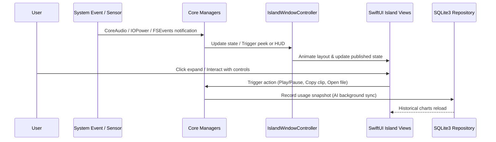

# Kiko Notch — Architecture Specification

> **Document Status**: Definitive System Architecture  
> **Target Platform**: macOS 13.0+ (Apple Silicon native)  
> **Frameworks**: Swift 6, AppKit, SwiftUI, CoreAnimation, EventKit, IOPowerSources, IOBluetooth, SQLite3  
> **Last Updated**: 2026-10-18  

---

## 1. System Overview

Kiko Notch is engineered as a lightweight, modular, native macOS dynamic island application. It bridges hardware displays (both physical MacBook notches and flat camera bezels) with a responsive floating interface.

```
+-----------------------------------------------------------------------------------+
|                                  macOS System                                     |
|  (CoreDisplay, EventKit, IOPowerSources, IOBluetooth, CoreAudio, FSEvents, etc.)  |
+-----------------------------------------+-----------------------------------------+
                                          |
                                          v
+-----------------------------------------------------------------------------------+
|                             Kiko Notch Architecture                               |
+-----------------------------------------+-----------------------------------------+
|                                         |
+-------------------+---------------------+--------------------+--------------------+
|  Core & Window    | Appearance & Theme  | System & Sensors   | AI Integrations    |
|  - IslandWindow   | - ThemeManager      | - AudioHUD         | - AIProviderProtocol
|  - DisplayManager | - GlassBackground   | - BrightnessHUD    | - Antigravity (Pri)|
|  - AnimationEngine| - ColorPalette      | - BatteryMonitor   | - Codex (Optional) |
|  - InteractionMgr | - GeometryConfig    | - BluetoothMonitor | - Claude (Optional)|
+-------------------+---------------------+--------------------+--------------------+
|  Media & Files    | Productivity & Util | Notifications & DL | Storage & Security |
|  - MediaController| - CalendarService   | - NotificationMgr  | - SQLite3 Repo     |
|  - AudioDeviceMgr | - ReminderService   | - DownloadMonitor  | - KeychainHelper   |
|  - FileShelfMgr   | - ClipboardManager  | - WeatherService   | - FeatureRegistry  |
+-------------------+---------------------+--------------------+--------------------+
```

---

## 2. Component Design & Responsibilities

### 2.1 Core & Window Management (`Sources/KikoNotch/Core/`)
- **`IslandWindowController`**: Manages a borderless `NSPanel` at `.statusBar` or `.floating` window level with `.nonactivatingPanel` mask, `.canJoinAllSpaces`, and optional `.sharingType = .none` (screen recording exclusion).
- **`DisplayManager`**: Queries `NSScreen.screens` and detects hardware notches via `auxiliaryTopLeftArea` / `auxiliaryTopRightArea`. For screens lacking a hardware notch, it computes the ideal floating pill position directly below the top camera bezel.
- **`IslandAnimationEngine`**: Coordinates fluid geometric morphs between `collapsed`, `peek`, and `expanded` states using spring timing curves (`CASpringAnimation` / SwiftUI spring interpolations) and honors system reduced-motion flags.
- **`InteractionManager`**: Handles mouse hover tracking areas with configurable entry/exit debounce delays, swipe gestures, click-outside global monitors, and hotkey toggling.

### 2.2 Appearance & Customization (`Sources/KikoNotch/Appearance/`)
- **`ThemeManager`**: Encapsulates active themes (Dark, Light, Auto, Liquid Glass Dark, Liquid Glass Light, and User Custom).
- **`GlassBackgroundView`**: Utilizes `NSVisualEffectView` with customizable material, blending modes, frost intensity, tint color, and border rendering.
- **`ColorPalette` & `IslandGeometry`**: Centralizes user-configurable accent colors, border colors, corner radii (10pt–32pt), and dimensions.

### 2.3 Media & File Shelf (`Sources/KikoNotch/Media/`, `Sources/KikoNotch/FileShelf/`)
- **`MediaController`**: Integrates with active macOS media sessions (Apple Music, Spotify). Detects track title, artist, playback state, and album artwork without polling when idle.
- **`AudioVisualizerView`**: Renders simulated animated equalizer bars synchronized with playback state, pausing timers entirely when audio is paused.
- **`FileShelfManager`**: Implements `NSDraggingDestination` and `NSDraggingSource`. Holds temporary security-scoped bookmarks or URLs for dropped files, generates QuickLook previews, and hooks into `NSSharingServicePicker` for native AirDrop sharing.

### 2.4 System HUD & Sensors (`Sources/KikoNotch/SystemHUD/`, `Sources/KikoNotch/Sensors/`)
- **`AudioHUDMonitor`**: Listens to CoreAudio default output changes and volume properties via `AudioObjectAddPropertyListenerBlock`.
- **`BrightnessHUDMonitor`**: Watches system brightness adjustments via notification listeners.
- **`BatteryMonitor`**: Subscribes to `IOPowerSources` run-loop sources (`IOPSCreateRunLoopSource`), reporting real battery percentages, AC/battery status, and time-to-full estimates without polling.
- **`BluetoothMonitor`**: Employs `IOBluetooth` to observe peripheral connections, disconnections, and accessory battery levels.

### 2.5 Productivity & System Integrations
- **`CalendarService` & `ReminderService`**: Uses `EventKit` to query today's upcoming appointments and overdue reminders with explicit permission handling.
- **`WeatherService`**: Connects to the free Open-Meteo API using CoreLocation coordinates or user-selected city, caching forecast snapshots locally.
- **`DownloadMonitor`**: Listens to `~/Downloads` via `FSEventStream` for `.crdownload`, `.download`, and `.part` files, surfacing animated progress and completion HUDs.
- **`ClipboardManager`**: Observes `NSPasteboard.general.changeCount`. Excludes password manager items (`org.nspasteboard.ConcealedType`), stores local history in encrypted storage, with zero network transmission.

### 2.6 AI Provider Architecture (`Sources/KikoNotch/AI/`)
- **`AIProviderAdapter` Protocol**: Common interface for connection checking, usage querying, error mapping, and quota status.
- **`AntigravityProvider`**: The primary provider, enabled by default. Inspects local Google Antigravity environment (`~/.gemini/antigravity`), CLI configuration, and active sessions. Never fabricates quota numbers.
- **`CodexProvider` & `ClaudeProvider`**: Optional providers, disabled by default. Store API credentials in macOS Keychain, execute network queries asynchronously with exponential backoff, and operate in total fault isolation from Antigravity.
- **`UsageRepository`**: SQLite3 database (`kiko_usage.sqlite3`) storing timestamped snapshots of request counts, token usage, and quota percent for daily/weekly charts.

---

## 3. Data Flow & Inter-Process Communication



---

## 4. Privacy, Security & Resource Attribution

1. **Zero Unsolicited Network Access**: Telemetry, crash analytics, and external tracker SDKs are prohibited. Network calls occur solely for user-configured weather and AI providers.
2. **Keychain Security**: All API keys and authentication tokens are secured via macOS Keychain Services (`SecItemAdd`, `SecItemCopyMatching`).
3. **No Private API Risks**: All features utilize documented macOS public frameworks (AppKit, EventKit, CoreAudio, IOPowerSources, IOBluetooth, FSEvents).
4. **Zero-Idle CPU**: When collapsed and inactive, all animation display links, visualizer loops, and frequent timers are stopped.
